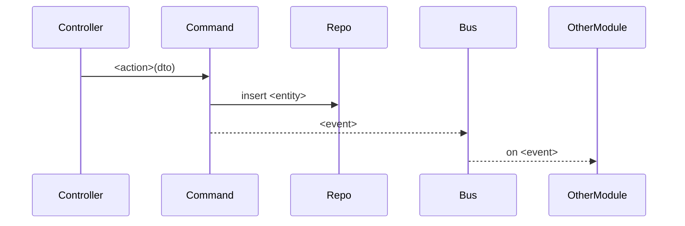

# Backend plan

## Research before the plan

- Read the project's `AGENTS.md` / `CLAUDE.md`, every installed skill that matches the task, every file the task touches.
- Find the closest existing module: it is the reference for style, structure and flow. Point to it from the File tree (`like <path>`) and from References.
- Reuse before new code: shared services, `libs/` helpers, types, installed libraries; list each in References. A new library only when nothing covers the need; latest stable version; its API checked via context7.
- Open questions → answer them from the project, docs and the web; still open → take the default and ask the user in chat, not in the plan.

## Design rules

- Code is a liability: reuse → extend → extract shared → installed library → new code.
- Follow the reference module's conventions, even where you would do it differently.
- Extract shared only for real duplication (Rule of Three).
- Variation points (vendor SDK, storage, notifications, payment, auth, AI) sit behind an interface, even with one implementation.
- Module graph acyclic; modules talk only through public APIs, never another module's internals or tables.
- DB: smallest column type that fits, every type explicit; indexes only for real filters, joins and sorts.

## Plan format

File: `.claude/plans/<kebab-case-name>.md`. **Only these sections, in this order, nothing else**: no goal, no descriptions, no prose, no reasoning, no checks. The coder understands the task from the examples, the tree and the diagrams.

1. **API** — one block per endpoint: method + path, request and response examples with realistic values, each error as `<status> <error.code>`. Omit when no endpoint changes.
2. **File tree** — every new `+`, changed `~` and removed `-` file. Each line: a comment of a few words on what the file holds or what changes, `like <path>` for the file to copy, `[N]` for the part.
3. **References** — project code the coders must look at or use: the reference implementation, shared libraries, modules, services, classes, helpers, types, installed libraries. Each line: `path` or `path#Symbol`, a few words on how to use it (`copy`, `call`, `extend`, `extract to <path>`), `[N]` for the parts that need it.
4. **Diagram** — Mermaid flowchart or sequence for modules, a flow or a structure, only when it is not obvious from the tree.
5. **DB** — Mermaid `erDiagram`: every changed table, every column with its exact type, `PK` / `FK` / `UK`, relations, indexes as column comments (`"idx"`, `"idx(a, b)"`, `"unique(a, b)"`). Omit when no table changes.

### Parts

- `[N]` in the File tree: every file belongs to exactly one part; one part = one coder, all parts run in parallel.
- A part that needs another part's code: `[N after M]`. Use only when the contract in the plan is not enough.
- A part is 2–6 files of one layer or one feature slice; fewer parts beat many tiny ones.
- Everything a coder needs to share with another part (a name, a type, a table) is fixed in the plan: API, DB or the tree comment.

## Example

Illustrative only. Copy the structure, never the names, values or logic.

````markdown
## API

```http
POST /v1/<resources>/:id/<action>
```
```json
{ "<field>": "<value>" }
```
```json
200
{ "data": { "id": "<uuid>", "<field>": "<value>", "createdAt": "2026-01-01T00:00:00Z" } }
```
```text
404 <resource>.not_found
409 <resource>.<conflict_reason>
```

```http
GET /v1/<resources>?status=<value>&limit=20&cursor=<cursor>
```
```json
200
{ "data": [{ "id": "<uuid>", "status": "<value>" }], "meta": { "nextCursor": "<cursor>" } }
```

## File tree

```
src/modules/<module>/
├── + <entity>.schema.ts          table <entity>, like src/modules/<other>/<other>.schema.ts   [1]
├── + <entity>.model.ts           model + status enum                                           [1]
├── + <action>/<action>.command.ts  creates <entity>, emits <event>, like src/modules/<other>/create/  [2]
├── + <action>/<action>.dto.ts    request/response of POST                                      [2]
├── ~ <module>.controller.ts      + POST /:id/<action>                                          [2 after 1]
└── + <action>/<action>.spec.ts   409 on duplicate, 404 on missing                              [2]
src/libs/<shared>/
└── + <helper>.ts                 extracted from src/modules/<other>/<file>.ts                  [3]
migrations/
└── + <timestamp>_<entity>.sql    generated                                                     [1]
```

## References

```
src/modules/<other>/                        reference implementation: structure, CQRS, tests   [1, 2]
src/libs/<pagination>/cursor.ts#paginate    call for the GET list                              [2]
src/modules/<auth>/<auth>.service.ts#<method>  call to check access, don't reimplement         [2]
src/modules/<other>/<file>.ts#<fn>          extract to src/libs/<shared>/<helper>.ts           [3]
<library>#<api>                             installed, use for <purpose>                       [3]
```

## Diagram



## DB

```mermaid
erDiagram
  <owner> ||--o{ <entity> : has
  <entity> {
    uuid id PK
    uuid owner_id FK "idx(owner_id, created_at)"
    varchar(64) external_id UK
    smallint status "idx"
    timestamptz created_at
  }
````
